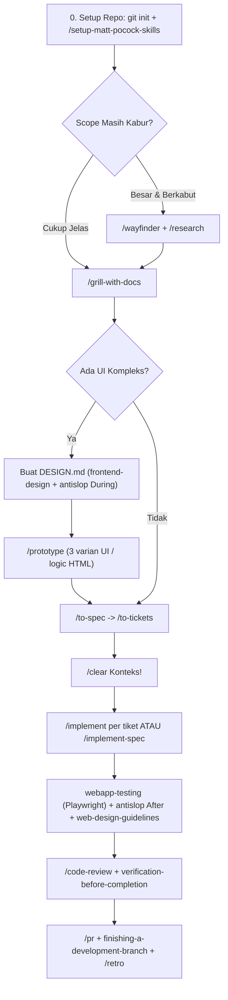
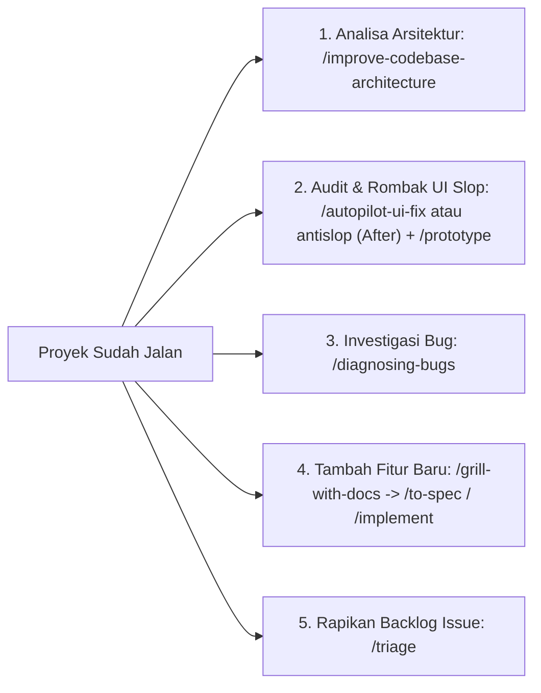

# Playbook Lengkap Ekosistem Agent Skills

Panduan komprehensif untuk mengoptimalkan seluruh **6 plugin** yang dipasang lewat setup ini—mulai dari membuat proyek baru **0 → finish**, menganalisa/merombak proyek yang sudah berjalan, mengatur agar agen langsung paham konteks secara otomatis, hingga backup multi-PC.

---

## 1. Peta Ekosistem Plugin Terinstal

| Plugin | Jumlah Skill | Peran Utama |
| :--- | :---: | :--- |
| **`autopilot-workflows`** *(Custom)* | 2 + Global Rule | Router otomatis (`rules/AGENTS.md`) & orkestrator 1x eksekusi (`/autopilot-build`, `/autopilot-ui-fix`) |
| **`mattpocock-skills`** | 27 | Alur kerja *idea → ship*, domain modeling (`GLOSSARY.md`, ADR), *vertical-slice* tickets, `/retro` |
| **`superpowers`** | 15 | Disiplin eksekusi engineering (brainstorming, git worktrees, TDD, `verification-before-completion`) |
| **`antislop`** | 6 + Global Rule | Filter anti *AI slop* (UI, copywriting, aksesibilitas, mobile layout, komentar kode) |
| **`vercel-agent-skills`** | 9 | Performa React/Next.js, *composition patterns*, audit 100+ aturan UX/a11y, deploy Vercel |
| **`anthropics-skills`** | 19 | Desain UI berkarakter (`frontend-design`), Playwright QA (`webapp-testing`), dokumen (`docx`/`pdf`/`pptx`/`xlsx`), `mcp-builder` |

### Aturan Dasar Agar Skill Tidak Saling Bentrok

* **Pilih satu "sopir alur kerja" (*process driver*) per tugas:**
  `mattpocock-skills` dan `superpowers` sama-sama punya alur perencanaan hingga TDD. Gunakan **`mattpocock-skills`** sebagai alur utama (karena menyertakan `GLOSSARY.md`, ADR, dan issue tracking), dan panggil skill spesifik dari `superpowers` (misal `verification-before-completion` atau `using-git-worktrees`) bila diperlukan.
* **Gabungkan *Quality & Domain Skills* secara berlapis:**
  Saat membangun frontend, padukan sekaligus:
  `frontend-design` (arah gaya) + `antislop` (filter slop) + `vercel-react-best-practices` & `vercel-composition-patterns` (arsitektur & performa) + `web-design-guidelines` (audit a11y/UX) + `webapp-testing` (uji browser nyata).
* **Kontrol kebisingan plugin per fase:**
  `antislop` memiliki rule global yang selalu aktif. Jika sedang fokus mengerjakan tugas non-UI murni (misal backend/database) dan tidak ingin ditanya mode `During/After`, Anda bisa menonaktifkan sementara plugin `antislop` di Customizations lalu menyalakannya lagi saat menyentuh frontend, atau set mode default lewat `npx antislop-ai --mode during`.

---

## 2. Auto-Orientation: Membuat Agen Langsung Paham di Setiap Sesi

Agar di setiap sesi baru agen langsung bergerak benar **tanpa perlu Anda jelaskan ulang**, gunakan **3 lapisan orientasi**:

### Lapisan 1 — Global Router (`autopilot-workflows/rules/AGENTS.md`)
Terpasang otomatis bersama plugin `autopilot-workflows`. Setiap sesi baru dibuka, agen otomatis membaca router ringkas ini sehingga tahu:
* Perintah bangun proyek/fitur instan → `/autopilot-build`.
* Perintah rombak UI *slop* instan → `/autopilot-ui-fix`.
* Pekerjaan UI → cek `DESIGN.md`, pakai `frontend-design` + `antislop` + `vercel-react-best-practices` + `web-design-guidelines` + `webapp-testing`.
* Bug/regresi → wajib punya reproduksi gagal dulu (`diagnosing-bugs` / `systematic-debugging`).
* Completion Gate → wajib jalankan test, typecheck, dan build nyata setelah edit terakhir.

### Lapisan 2 — Project-Level `AGENTS.md` (Template Per Repo)
Taruh `AGENTS.md` ringkas di root setiap proyek baru (hanya berisi *navigation pointers* + perintah verifikasi, tidak bertele-tele):

```markdown
# Project Instructions

## Read First
- Domain terms: `GLOSSARY.md`
- Architecture decisions: `docs/adr/`
- UI direction & tokens: `DESIGN.md`
- Specs & tickets: `.scratch/` (see `docs/agents/issue-tracker.md`)

## Verification Commands
- Backend tests: `<misal: pytest>`
- Frontend checks: `<misal: npm run typecheck && npm run lint && npm test && npm run build>`
```

### Lapisan 3 — Preferensi Mode `antislop` (Opsional)
Agar `antislop` di sesi non-autopilot tidak terus bertanya *"1. During atau 2. After?"*, jalankan sekali:
```powershell
npx antislop-ai --mode during
```
*(Menyimpan `{"mode":"during"}` di `%APPDATA%\antislop\settings.json`, atau gunakan flag `.\install-all.ps1 -AntislopMode during` saat install.)*

---

## 3. Memilih Mode Eksekusi: Autopilot (1x Klik) vs Interaktif

| Kondisi | Pilih Mode | Cara Pakai |
| :--- | :--- | :--- |
| Gambaran sudah jelas, ingin selesai cepat dalam 1 perintah | **Autopilot (1x Eksekusi)** | `/autopilot-build ...` atau `/autopilot-ui-fix ...` *(bisa ditambah `/goal` agar ekstra gigih)* |
| Ide masih mentah, banyak keputusan bisnis/protokol berisiko tinggi | **Interaktif (Step-by-Step)** | `/setup-matt-pocock-skills` → `/grill-with-docs` → `/to-spec` → `/to-tickets` → `/implement` |

---

## 4. Skenario 1: Membuat Proyek dari 0 → Finish (Greenfield)



### Jalur Cepat (1x Eksekusi)
Buat folder proyek + `git init`, buka sebagai active workspace, lalu jalankan:
```text
/autopilot-build Buat aplikasi [jelaskan produk, fitur inti, stack yang diinginkan jika ada, dan gaya UI].
```

### Jalur Terkendali (Step-by-Step)
1. **Fase 0 — Fondasi Repo:** `git init` → jalankan `/setup-matt-pocock-skills` (pilih Local markdown `.scratch/` atau GitHub Issues, dan `AGENTS.md`).
2. **Fase 1 — Kunci Domain & Arsitektur *(jangan `/clear` di sini!)*:**
   * Jika sangat besar/berkabut: `/wayfinder` *(dibantu `/research` untuk riset sumber primer)*.
   * Jika scope sudah terbayang: `/grill-with-docs` → otomatis mencatat `GLOSSARY.md` dan `docs/adr/`.
3. **Fase 2 — Kunci Identitas Visual & Prototipe *(jika ada UI)*:**
   * Buat `DESIGN.md` di root repo memakai `frontend-design` + `antislop` (mode **During**).
   * Uji layout sebelum menulis kode penuh dengan `/prototype` (`?variant=A|B|C` + *floating switcher*).
4. **Fase 3 — Spesifikasi & Pemecahan Tiket *(masih dalam sesi yang sama)*:**
   * `/to-spec` → `/to-tickets` (menghasilkan *vertical tracer-bullet slices* + *blocking edges*).
5. **Fase 4 — Eksekusi Implementasi *(wajib `/clear` sebelum mulai!)*:**
   * Jalankan `/implement <path-tiket>` satu per satu (disertai `/clear` antar tiket), **atau** `/implement-spec` untuk eksekusi paralel di git worktree.
   * Tiket backend dipandu `/tdd`; tiket frontend dipandu `DESIGN.md` + `antislop` + `vercel-react-best-practices` + `vercel-composition-patterns`.
6. **Fase 5 — Uji Nyata, Review & Retro:**
   * Uji di browser dengan `webapp-testing` (Playwright) + audit `web-design-guidelines`.
   * Jalankan `/code-review` (Standards + Spec) dan pastikan `verification-before-completion` terpenuhi.
   * Tutup dengan `/pr` (atau `finishing-a-development-branch`) dan `/retro` sebelum `/clear`.

---

## 5. Skenario 2: Analisa & Perbaikan Proyek yang Sudah Berjalan (Existing Codebase)



### A. Merombak UI Proyek yang Terlanjur "Slop"
* **1x Eksekusi (Instan):**
  ```text
  /autopilot-ui-fix audit dan rombak total UI proyek ini agar bebas slop dengan gaya [sebutkan gaya/referensi]
  ```
* **Bertahap (Audit → Pilih Varian → Rombak):**
  1. Buat commit Git baseline terlebih dahulu.
  2. Jalankan audit read-only memakai `antislop` mode **After** (`antislop-ui`, `antislop-copywriting`, `antislop-human`, `antislop-layoutmobile`, `antislop-code`) + `web-design-guidelines` + `vercel-react-best-practices`.
  3. Tetapkan `DESIGN.md` dengan `frontend-design`.
  4. Jika perlu membandingkan beberapa layout baru, jalankan `/prototype` (`?variant=A|B|C` pada route yang sudah ada).
  5. Terapkan dan verifikasi desktop + mobile dengan `webapp-testing` (Playwright).

### B. Analisa Kesehatan Arsitektur Kode
* Jalankan **`/improve-codebase-architecture`** (didukung kosakata **`/codebase-design`**) untuk memindai hot-spot dari `git log`, menemukan *shallow modules* & kebocoran *seam*, dan menghasilkan laporan HTML *deepening opportunities*.

### C. Investigasi Bug Membandel / Regresi
* Jalankan **`/diagnosing-bugs`** (atau `systematic-debugging`). Agen wajib membuat *tight feedback loop* (repro/test yang konsisten gagal merah) terlebih dahulu sebelum mengubah kode, lalu menambah regression test permanen dan menutup dengan `/retro`.

### D. Menambah Fitur Baru ke Proyek yang Sudah Jalan
1. Pastikan working tree bersih (commit perubahan sebelumnya).
2. Jalankan `/grill-with-docs <ide fitur>` (otomatis memakai `GLOSSARY.md` & `docs/adr/` yang sudah ada).
3. Fitur kecil → langsung `/implement`. Fitur besar → `/to-spec` → `/to-tickets` → `/clear` → `/implement` / `/implement-spec` (atau `/autopilot-build tambah fitur <fitur>`).

### E. Memilah Backlog / Laporan Bug Masuk
* Jalankan **`/triage`** untuk memvalidasi laporan bug/request dari luar hingga berstatus `ready-for-agent`.

---

## 6. Skenario 3: Kebutuhan Spesifik & Utilitas Tambahan

| Kebutuhan | Skill yang Dipakai | Keterangan Singkat |
| :--- | :--- | :--- |
| **Setup manual oleh manusia** (`.env`, API key, RADIUS secret, DNS) | **`/wizard`** | Membuat skrip bash interaktif langkah-demi-langkah dengan input tersembunyi ke `.env` / GitHub secrets. |
| **Riset dokumen/library eksternal** | **`/research`** | Menugaskan sub-agent mencari fakta dari sumber primer dan menyimpan ringkasan ber-sitasi ke Markdown. |
| **Butuh jawaban dari klien/tim lain** | **`/to-questionnaire`** | Menyusun kuesioner terarah untuk menutup gap informasi yang hanya diketahui pihak lain. |
| **Optimasi performa/biaya deploy Vercel** | **`vercel-optimize`**, **`deploy-to-vercel`** | Audit berbasis metrik `signals.json` untuk Next.js/Vercel. |
| **Bikin laporan/presentasi/Excel** | **`docx`**, **`pdf`**, **`pptx`**, **`xlsx`**, **`theme-factory`** | Menghasilkan atau mengekstrak dokumen kerja berformat rapi. |
| **Membangun MCP Server baru** | **`mcp-builder`** | Panduan lengkap FastMCP (Python) & MCP SDK (TypeScript). |
| **Membuat / menguji skill baru** | **`skill-creator`** / **`writing-skills`** | Authoring `SKILL.md` lengkap dengan evaluasi akurasi trigger. |
| **Belajar konsep bertahap di repo** | **`/teach`** | Mengubah direktori kerja menjadi ruang belajar terstruktur multi-sesi. |

---

## 7. Cheat Sheet Prompt Siap Pakai

### 1. Mulai Proyek Baru (1x Jalan)
```text
/autopilot-build Buat aplikasi [nama/jenis app] dengan fitur [fitur utama], tech stack [opsional], dan gaya visual [opsional].
```

### 2. Rombak UI Existing (1x Jalan)
```text
/autopilot-ui-fix Audit dan rombak seluruh frontend di proyek ini agar bebas AI slop, responsif, dan bergaya [referensi gaya].
```

### 3. Audit UI Manual Sebelum Mengubah Kode
```text
Gunakan antislop mode AFTER (antislop-ui, antislop-human, antislop-layoutmobile), web-design-guidelines, dan vercel-react-best-practices untuk mengaudit seluruh UI di frontend/src/. Tampilkan daftar temuan prioritas tanpa mengubah kode dulu.
```

### 4. Analisa Arsitektur Proyek Lama Sebelum Refactor
```text
/improve-codebase-architecture Fokus analisa pada area [nama modul/folder] untuk mencari shallow module dan perbaikan seam testability.
```
