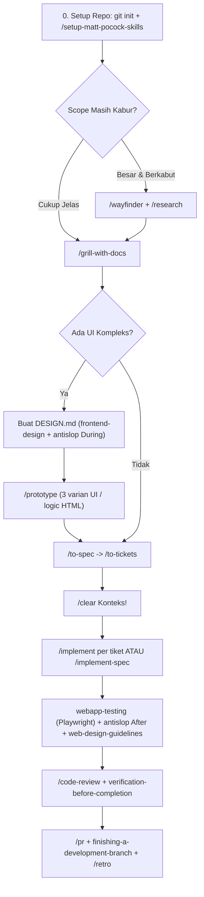
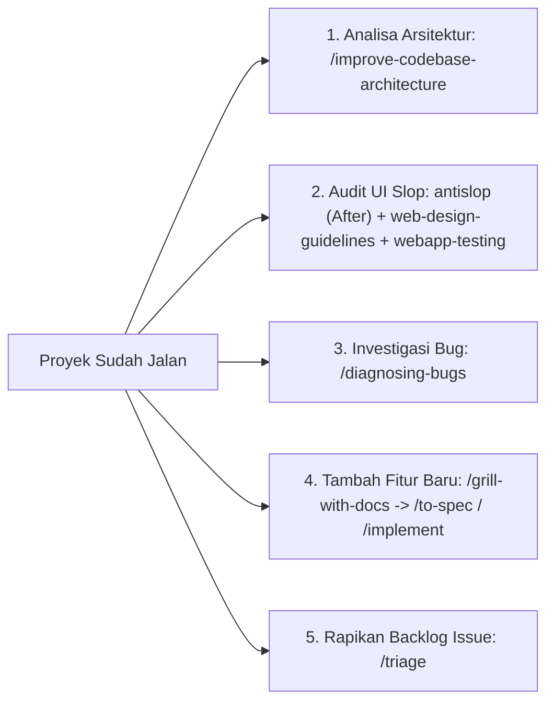

# Playbook Optimasi AI Agent Skills (Project 0 → Finish & Existing Codebase)

Panduan ini merangkum cara menggabungkan seluruh plugin yang sudah terinstal di environment Anda secara efektif tanpa saling tumpang tindih:

1. **`mattpocock-skills` (27 skills)** — Mesin alur kerja utama (*planning → ticketing → build → retro*) & pemodelan domain.
2. **`superpowers` (15 skills)** — Disiplin eksekusi engineering (*brainstorming*, *worktree isolation*, *TDD*, *verification*).
3. **`antislop` (6 skills + global rules)** — Filter penghapus *AI slop* untuk UI, copywriting, aksesibilitas, layout mobile, dan komentar kode.
4. **`vercel-agent-skills` (9 skills)** — Standar performa React/Next.js, pola komposisi, audit UX/a11y, dan deployment Vercel.
5. **`anthropics-skills` (19 skills)** — Desain UI berkarakter (`frontend-design`), Playwright E2E testing (`webapp-testing`), dokumen kantor (`docx`/`pdf`/`pptx`/`xlsx`), dan `mcp-builder`.

---

## Aturan Dasar Agar Skill Tidak Saling Bentrok

* **Pilih satu "sopir alur kerja" (*process driver*) per tugas:**
  `mattpocock-skills` dan `superpowers` sama-sama punya alur perencanaan hingga TDD. Gunakan **`mattpocock-skills`** sebagai alur utama (karena punya `GLOSSARY.md`, ADR, dan issue tracking), dan panggil skill tertentu dari `superpowers` (misal `verification-before-completion` atau `using-git-worktrees`) hanya bila dibutuhkan.
* **Gabungkan *Quality & Domain Skills* secara berlapis:**
  Saat membangun frontend, padukan sekaligus:
  `frontend-design` (arah gaya) + `antislop` (filter slop) + `vercel-react-best-practices` & `vercel-composition-patterns` (arsitektur & performa) + `web-design-guidelines` (audit a11y/UX) + `webapp-testing` (uji browser nyata).
* **Kontrol kebisingan plugin per fase:**
  `antislop` memiliki rule global yang selalu aktif. Jika Anda sedang fokus mengerjakan tugas non-UI murni (misal backend collector/database) dan tidak ingin diganggu pertanyaan mode `During/After`, Anda bisa menonaktifkan sementara `[antislop](customization://antislop)` lalu menyalakannya kembali saat menyentuh frontend.

---

## Skenario 1: Membuat Proyek dari 0 sampai Finish (Greenfield)



### Fase 0: Siapkan Fondasi Repo
1. Buat folder proyek, jalankan `git init`, dan jadikan **active workspace**.
2. Jalankan **`/setup-matt-pocock-skills`** untuk menetapkan:
   * Lokasi issue tracker (`.scratch/<fitur>/` lokal atau GitHub Issues).
   * Triage labels dan layout `GLOSSARY.md` + `docs/adr/`.

### Fase 1: Kunci Domain & Arsitektur *(Jangan `/clear` di fase ini!)*
* **Jika ide masih sangat besar / penuh ketidakpastian teknis:**
  1. Jalankan **`/wayfinder`** untuk memecah kabut menjadi *decision tickets* (`research`, `prototype`, `grilling`, `task`) sebelum menulis spec.
  2. Gunakan **`/research`** untuk mendelegasikan riset dokumentasi/protokol ke background agent.
* **Jika scope sudah terbayang:**
  * Jalankan **`/grill-with-docs`** — agen akan mewawancarai Anda ronde demi ronde sambil mencatat istilah domain ke `GLOSSARY.md` (`domain-modeling`) dan keputusan trade-off ke `docs/adr/`.

### Fase 2: Kunci Identitas Visual & Prototipe *(Khusus proyek ber-UI)*
Jangan langsung masuk ke `/implement` sebelum arah UI jelas agar tidak berakhir sebagai *AI slop*:
1. **Buat `DESIGN.md` di root repo** menggunakan skill **`frontend-design`** + **`antislop`** (mode **During**). Tentukan palet warna, tipografi (misal font mono *tabular-nums* untuk angka/IP), kepadatan layout, dan kepribadian produk.
2. **Uji layout sebelum produksi** dengan **`/prototype`** (cabang UI): buat 3 variasi layout yang strukturnya berbeda (`?variant=A|B|C` + *floating switcher*), pilih pemenang atau gabungkan elemen terbaiknya.
3. *(Jika butuh validasi logika/state machine yang rumit, pakai **`/prototype`** cabang logic untuk membuat simulasi HTML satu file.)*

### Fase 3: Spesifikasi & Pemecahan Tiket *(Masih dalam sesi yang sama)*
1. Jalankan **`/to-spec`** untuk merangkum diskusi + `GLOSSARY.md` + ADR menjadi `spec.md`.
2. Jalankan **`/to-tickets`** untuk memecah spec menjadi *vertical tracer-bullet slices* (masing-masing lengkap DB + backend + UI + test, ukurannya muat dalam 1 sesi bersih) lengkap dengan *blocking edges*.

### Fase 4: Eksekusi Implementasi *(Wajib `/clear` sebelum mulai!)*
* Lakukan **`/clear`** agar konteks kembali tajam (~150k *smart zone*).
* Pilih cara eksekusi:
  * **Kontrol penuh bertahap:** Jalankan **`/implement <path-tiket>`** satu per satu sesuai *frontier* tiket yang tidak terblokir, lakukan **`/clear`** di antara setiap tiket.
  * **Otomatis paralel:** Jalankan **`/implement-spec`** agar sub-agent bekerja paralel di git worktree terpisah menuju satu *integration branch*.
* **Tips Prompt Tambahan Saat Mengerjakan Tiket Frontend:**
  > *"Kerjakan tiket ini sambil menerapkan `DESIGN.md`, `antislop` mode during (`antislop-ui`, `antislop-human`, `antislop-layoutmobile`), `vercel-react-best-practices`, dan `vercel-composition-patterns`."*
* Backend/logic otomatis dipandu oleh **`/tdd`** (siklus Red-Green-Refactor).

### Fase 5: Pengujian Nyata, Review & Penutupan
1. **Uji Aplikasi di Browser:** Minta agen menjalankan **`webapp-testing`** (Playwright script untuk cek interaksi UI, error console, serta screenshot desktop & mobile).
2. **Audit Desain & Kode:**
   * Jalankan **`web-design-guidelines`** untuk audit 100+ aturan aksesibilitas/UX.
   * Jalankan **`/code-review`** (review dua sumbu terpisah: **Standards** vs **Spec**).
   * Pastikan **`verification-before-completion`** terpenuhi (semua test & build benar-benar dijalankan dan lolos setelah edit terakhir).
3. **Ship & Evaluasi Lingkungan:**
   * Jika memakai PR, deskripsi PR dibentuk oleh **`/pr`** (atau **`finishing-a-development-branch`** untuk merge/cleanup worktree).
   * Jalankan **`/retro`** sebelum `/clear` untuk meninjau apakah ada guardrail (lint, test, `CODING_STANDARDS.md`, pointer `AGENTS.md`) yang perlu ditambahkan agar sesi berikutnya makin cepat.

---

## Skenario 2: Analisa & Perbaikan Proyek yang Sudah Berjalan (Existing Codebase)



### A. Analisa Kesehatan Arsitektur Kode
* **Kapan dipakai:** Codebase terasa kusut, modul sulit dites, atau agen sering bolak-balik file untuk memahami satu fitur.
* **Skill:** **`/improve-codebase-architecture`** (didukung kosakata **`/codebase-design`**).
* **Cara kerja:** Memindai hot-spot dari `git log`, menemukan *shallow modules* & kebocoran *seam*, lalu menghasilkan laporan visual HTML berisi kandidat *deepening* yang bisa Anda pilih untuk di-refactor lewat `/grill-with-docs` → `/implement`.

### B. Audit & Perombakan UI Proyek yang Terlanjur "Slop"
Urutan paling efektif untuk memperbaiki frontend yang sudah terlanjur dibuat:
1. **Pastikan ada commit Git baseline** agar semua perubahan UI bisa di-diff dan di-review.
2. **Tetapkan arah desain (`DESIGN.md`):** Gunakan **`frontend-design`** untuk merumuskan arah visual spesifik proyek (jangan langsung edit CSS sebelum ada `DESIGN.md`).
3. **Audit menyeluruh tanpa langsung mengubah kode (Read-Only Audit):**
   * Jalankan **`antislop`** dalam **Mode `AFTER`** (`antislop-ui`, `antislop-copywriting`, `antislop-human`, `antislop-layoutmobile`, `antislop-code`). Agen akan menulis daftar temuan bernomor (`HIGH`/`MEDIUM`/`LOW`) ke `anti-slop/audit-001-YYYY-MM-DD.md`. Anda pilih nomor mana yang disetujui untuk diperbaiki.
   * Lengkapi dengan audit **`web-design-guidelines`** (fokus keyboard, kontras, semantik HTML, `tabular-nums`) dan **`vercel-react-best-practices`** (waterfall fetching, re-render berlebihan).
4. **Jika butuh perombakan layout besar:** Pakai **`/prototype`** (Sub-shape A: `?variant=A|B|C` pada route yang sudah ada agar data asli tetap jalan) untuk membandingkan 3 desain baru sebelum menimpa kode lama.
5. **Verifikasi visual:** Jalankan **`webapp-testing`** untuk mengambil screenshot dan memverifikasi tidak ada layout rusak/overflow di desktop maupun mobile.

### C. Analisa & Perbaikan Bug Membandel / Regresi
* **Skill:** **`/diagnosing-bugs`** (`mattpocock`) atau **`systematic-debugging`** (`superpowers`).
* **Prinsip:** Agen dilarang menebak-nebak perbaikan sebelum memiliki **tight feedback loop** (satu perintah test/repro yang konsisten gagal merah pada bug tersebut), lalu memperbaiki akar masalahnya disertai regression test permanen, dan menutupnya dengan **`/retro`**.

### D. Menambah Fitur Baru ke Proyek yang Sudah Jalan
1. Pastikan branch bersih (commit perubahan sebelumnya).
2. Jalankan **`/grill-with-docs <ide fitur>`** (otomatis membaca `GLOSSARY.md` & `docs/adr/` yang sudah ada).
3. Jika fitur kecil → langsung **`/implement`**. Jika fitur besar → **`/to-spec`** → **`/to-tickets`** → `/clear` → **`/implement`** / **`/implement-spec`**.
4. Tutup dengan **`/code-review`** dan **`/retro`**.

### E. Memilah Issue / Bug Report yang Menumpuk
* **Skill:** **`/triage`** (hanya untuk laporan bug/request dari luar, bukan tiket buatan `/to-tickets`). Memvalidasi dan memberi label hingga berstatus `ready-for-agent`.

---

## Skenario 3: Kebutuhan Spesifik & Utilitas Tambahan

| Kebutuhan | Skill yang Dipakai | Keterangan Singkat |
| :--- | :--- | :--- |
| **Setup manual oleh manusia** (`.env`, API key, RADIUS secret, DNS) | **`/wizard`** | Membuat skrip bash interaktif langkah-demi-langkah dengan input tersembunyi ke `.env` / GitHub secrets. |
| **Riset dokumen/library eksternal** | **`/research`** | Menugaskan sub-agent mencari fakta dari sumber primer dan menyimpan ringkasan ber-sitasi ke Markdown. |
| **Butuh jawaban dari klien/tim lain** | **`/to-questionnaire`** | Menyusun kuesioner terarah untuk menutup gap informasi yang hanya diketahui pihak lain. |
| **Optimasi performa/biaya deploy Vercel** | **`vercel-optimize`**, **`deploy-to-vercel`** | Audit berbasis metrik `signals.json` untuk Next.js/Vercel. |
| **Bikin laporan/presentasi/Excel** | **`docx`**, **`pdf`**, **`pptx`**, **`xlsx`**, **`theme-factory`** | Menghasilkan atau mengekstrak dokumen kerja berformat rapi. |
| **Membangun MCP Server baru** | **`mcp-builder`** | Panduan lengkap FastMCP (Python) & MCP SDK (TypeScript). |
| **Membuat / menguji skill baru** | **`skill-creator`** / **`writing-skills`** | Authoring `SKILL.md` lengkap dengan evaluasi akurasi trigger. |
| **Belajar konsep bertahap di repo** | **`/teach`** | Mengubah direktori kerja menjadi ruang belajar terstruktur multi-sesi. |

---

## Cheat Sheet Prompt Siap Pakai

### 1. Memulai Proyek Baru dari 0
```text
/setup-matt-pocock-skills
```
*(Setelah selesai)*
```text
/grill-with-docs Saya ingin membuat aplikasi [jelaskan ide proyek, target user, dan fitur inti].
```

### 2. Merombak UI Proyek yang Terlanjur "Slop" (seperti NMS BGP)
**Langkah 1 — Audit dulu (tanpa ubah file):**
```text
Gunakan antislop mode AFTER (antislop-ui, antislop-human, antislop-layoutmobile), web-design-guidelines, dan vercel-react-best-practices untuk mengaudit seluruh UI di frontend/src/. Tampilkan daftar temuan prioritas tanpa mengubah kode dulu.
```
**Langkah 2 — Buat arah desain + 3 varian layout:**
```text
Gunakan frontend-design untuk membuat DESIGN.md yang sesuai dengan karakter aplikasi ini, lalu jalankan /prototype di halaman utama untuk membuat 3 variasi layout (?variant=A|B|C) yang benar-benar berbeda strukturnya.
```
**Langkah 3 — Terapkan & uji Playwright:**
```text
Terapkan varian pilihan saya dengan antislop mode DURING, patuhi vercel-react-best-practices dan vercel-composition-patterns, lalu verifikasi tampilan desktop & mobile menggunakan webapp-testing (Playwright).
```

### 3. Analisa Proyek Lama Sebelum Refactor
```text
/improve-codebase-architecture Fokus analisa pada area [nama modul/folder] untuk mencari shallow module dan perbaikan seam testability.
```
